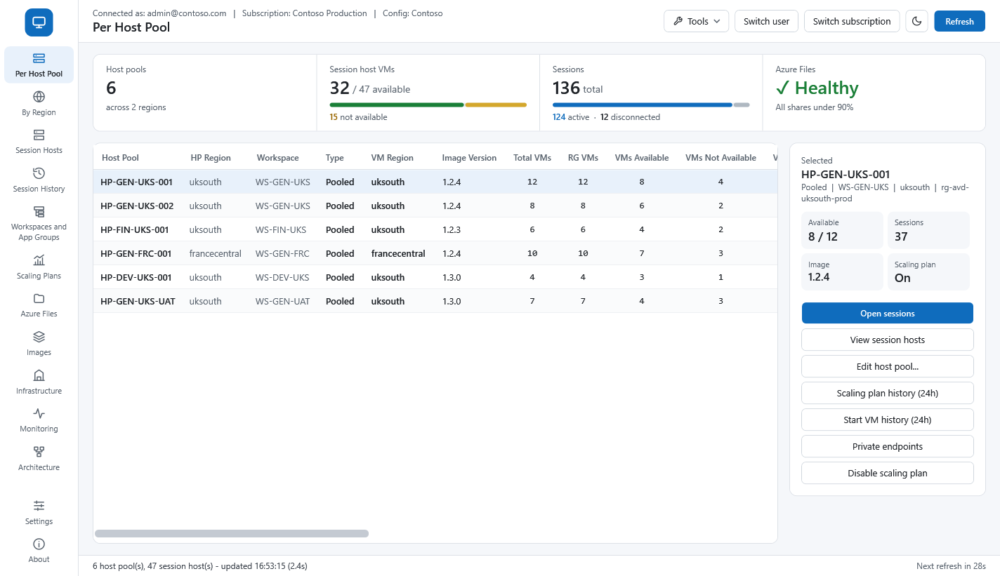
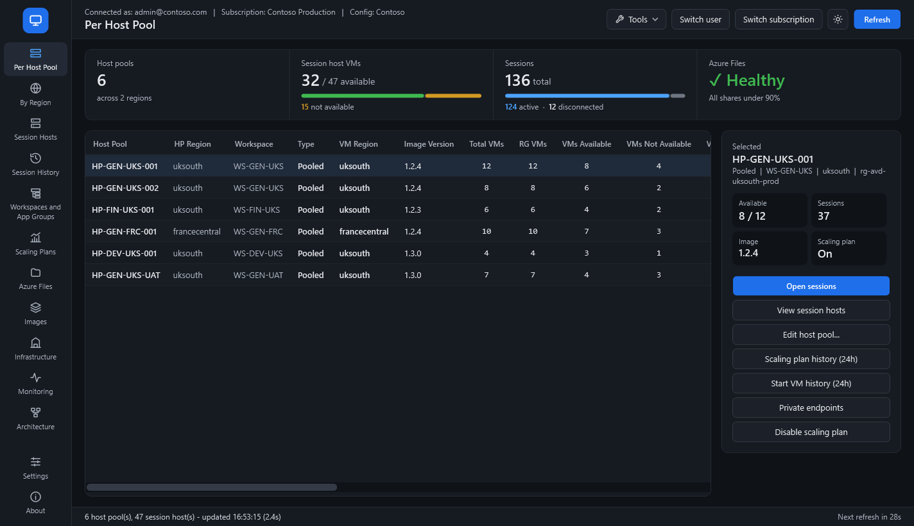
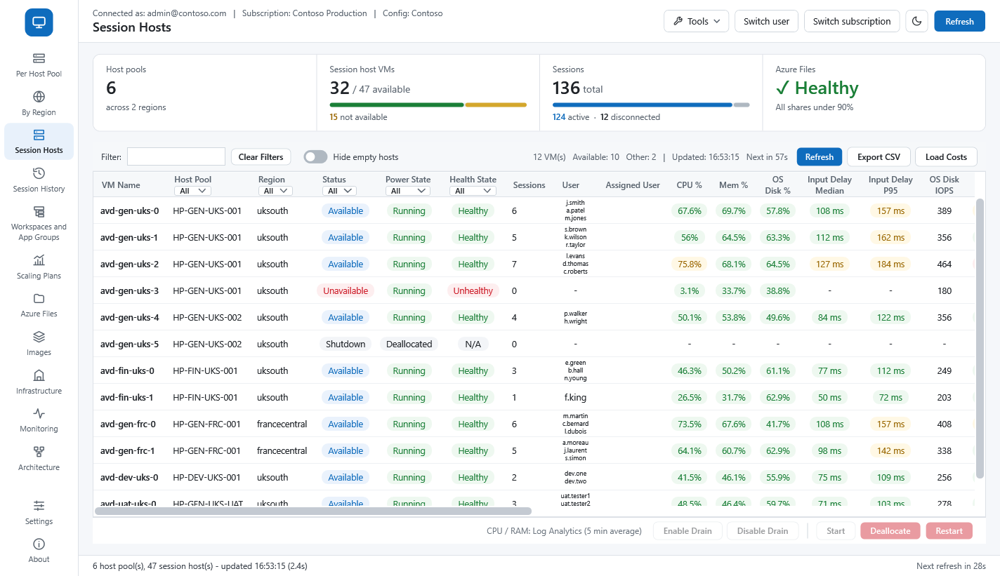
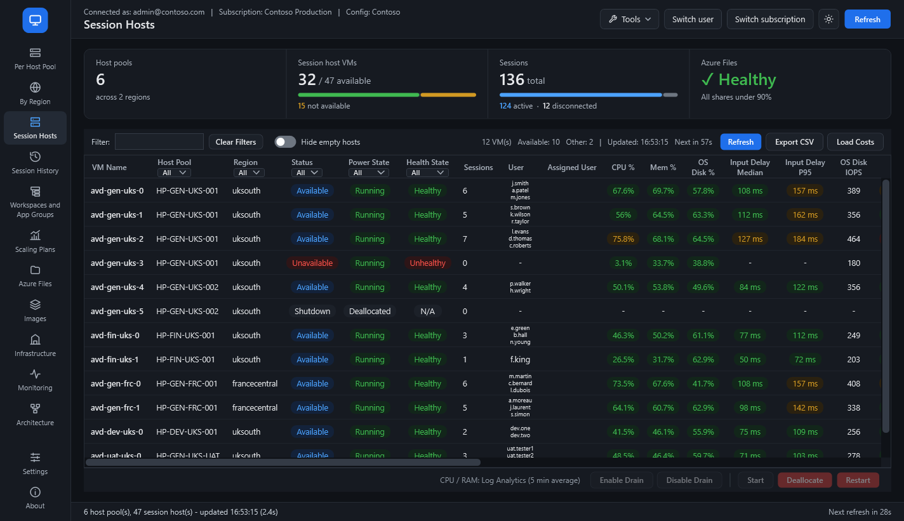
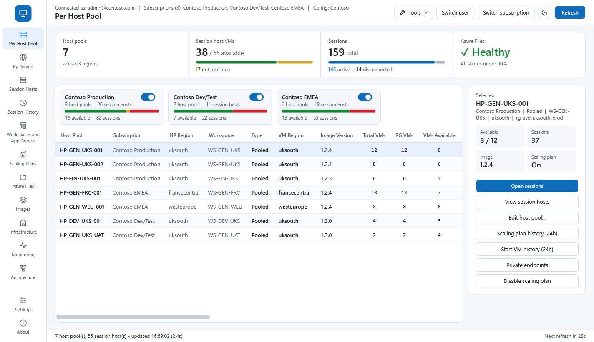
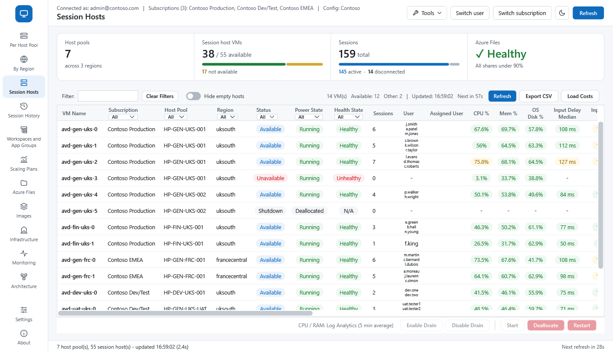

# AVD Live Dashboard 2026-11-12.45

**Release Date** 12 November 2026

---

**Overview**

A live dashboard for Azure Virtual Desktop. One window shows your host pools, session hosts, user sessions,
workspaces and app groups, scaling plans, images, costs and more, and lets you act on them (drain, start,
restart, add hosts, create host pools and so on). 

**Screenshots**

Sample data (Contoso); light and dark themes.

| Light | Dark |
| --- | --- |
|  |  |
| *Per Host Pool: summary strip, host pools and the selected pool's details and actions* | |
|  |  |
| *Session Hosts: status, sessions and users, CPU / memory / disk / input delay heat map* | |

**Several subscriptions at once**

Pick more than one in Switch subscription: each gets a card (with a switch to hide it) and a Subscription column.





**Requirements**

- Windows 10 or 11 (64-bit), or Windows Server 2016 or later. Nothing to install - the .NET runtime is inside the exe.
- An Azure account (Microsoft Entra ID sign-in, MFA supported) with access to the subscription. Viewing needs read access; changes need the matching permissions.
- Internet access to Azure (Azure Resource Manager and Microsoft Entra sign-in). Updates are checked on GitHub.
- A config file (`*.psd1`) in a `config` folder next to the exe, or in `%APPDATA%\AVDDashboard\config`.

**Getting started**

1. Download `AVD-Dashboard.exe` and put it in a folder of its own, for example `C:\Tools\AVD-Dashboard`.
2. Run it and sign in with your Azure account. MFA works as usual.
3. With no config file, it opens on your account's first subscription, which is enough to look around. Use **Switch subscription** to pick another, or tick several to see them together.

**Config file and Settings: what's the difference?**

| | Config file | Settings |
| --- | --- | --- |
| What | Your environment: tenant, subscriptions, workspace, resource groups to include or exclude, image and storage options | Your own preferences: refresh intervals, hidden tabs and columns, theme, thresholds |
| Where | A `*.psd1` file in a `config` folder next to the exe, or in `%APPDATA%\AVDDashboard\config` | The **Settings** button in the dashboard, saved for your Windows user (separately for each config) |
| Who | Usually one file shared by the team | Each person |
| Changes apply | After **Reload config** in Settings | Straight away |

A minimal config file:

```powershell
@{
    Name  = 'Contoso Production'
    Azure = @{
        TenantId       = '00000000-0000-0000-0000-000000000000'
        SubscriptionId = '11111111-1111-1111-1111-111111111111'
    }
}
```

- **Log Analytics workspace:** if you don't set one, the dashboard finds it from your host pools' diagnostic settings.
- **Several environments:** put one config file per environment in the `config` folder. The dashboard asks which to use at start-up and can remember your choice.
- **Editing:** use **Tools → Config Editor** instead of editing the file by hand.

---

**Executable**

AVD-Dashboard.exe (60.3 MB, standalone - nothing to install)

Download: https://github.com/virtualwebber/AVD-Dashboard-v2/releases/latest

**Checksums**

SHA256 - 77C88BB75EBA0A9FD163271168641703FE9A6BB3CE71B2787F8C7F0A456C3DAE

**VirusTotal Result**

This build was not scanned.

To check a download: `Get-FileHash .\AVD-Dashboard.exe -Algorithm SHA256`